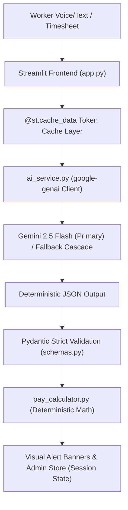

# 🛡️ FairShift — Decent Work Platform (UN SDG 8)

> **Empowering manual workforces through confidential, multilingual safety reporting, retaliation-proof anonymization, and algorithmic wage theft auditing.**  
> Built for the Hack2Skill Hackathon Challenge using **Google Gemini (`gemini-2.5-flash`)**, Streamlit, and Pydantic.

---

## 🌟 Executive Summary & Mission (UN SDG 8)

Manual labor forces around the world—such as construction crews, campus maintenance, and facility custodial staff—frequently face severe workplace vulnerabilities:
1. **Language & Literacy Barriers:** Non-English native dialects prevent timely hazard reporting.
2. **Fear of Retaliation:** Workers who speak up about dangerous scaffolding, broken equipment, or missing PPE face termination or blacklisting.
3. **Informal Wage Theft & Fatigue Exploitation:** Unrecorded overtime, arbitrary cash deductions, and 14+ hour continuous shifts cause devastating physical injuries and wage shortfalls.

**FairShift** operationalizes **UN Sustainable Development Goal 8 (Decent Work and Economic Growth)** by providing a dual-interface platform that bridges the communication gap between vulnerable workers and safety administrators.

---

## 🏗️ Cross-Industry Use Cases

FairShift is engineered to support and demonstrate immediate utility across distinct manual labor sectors:

### Sector 1: Construction Sites
* **Safety & Hazard Challenges:** High-elevation scaffolding without guardrails or safety harnesses, live dangling 440V electrical cables near wet concrete pour zones, and heavy machinery operating too close to ground laborers.
* **Health & Fatigue Vulnerabilities:** 14- to 16-hour continuous shifts under extreme ambient heat (e.g., 102°F) leading to heat syncope, muscle cramps, and dangerous cognitive lapses.
* **Wage Compliance Issues:** Off-the-books flat cash payments with illegal deductions (e.g., deducting $20 for drinking water or equipment transport) and refusal of statutory 1.5x overtime rates.
* **FairShift in Action:** Workers speak in their native tongue (e.g., Hindi/mixed dialect); Gemini translates the report, extracts strict safety red flags (fractured scaffolding plank, exposed 440V cables), scrubs worker and foreman names to protect the worker, and automatically calculates backpay owed ($159.50) from uncredited overtime.

### Sector 2: College Support & Facility Staff
* **Safety & Hazard Challenges:** Custodial teams handling hazardous chemicals (ammonia, chlorine) in poorly ventilated sub-basements without organic vapor respirators, and carrying 60lb chemical barrels up staircases due to broken service elevators.
* **Health & Fatigue Vulnerabilities:** Night custodial crews forced into double shifts during university commencement/football weekends (e.g., 10 PM to 2 PM continuous = 16 hours), resulting in vehicle and floor-scrubber accidents.
* **Wage Compliance Issues:** Misclassifying weekend campus event hours as "voluntary" or "stipend work" rather than statutory hourly labor with overtime.
* **FairShift in Action:** A worker submits an audio transcript in Spanish reporting chemical fumes in Building C basement; Gemini translates the text, flags acute respiratory distress, strips employee IDs, and triggers an immediate hazardous material team dispatch on the Admin Dashboard.

---

## 🚀 Key Features & Dual Interfaces

FairShift features a responsive sidebar toggle to seamlessly navigate between two purpose-built environments:

### Interface 1: Worker Portal (Mobile & Accessibility Friendly)
* **Feature 1 — Multilingual Safety & Feedback Reporter:**
  * Simulates voice transcription or local dialect input (Hindi, Spanish, Bengali, Tagalog, colloquial worker phrasing).
  * Gemini translates the input to plain English, extracts strict safety red flags without hallucination, and enforces retaliation shielding.
  * Displays high-visibility visual banners:
    * 🔴 **Red Banner:** Urgent life-safety hazard requiring immediate work stoppage.
    * 🟡 **Yellow Banner:** Warning notice requiring attention within 24 hours.
    * 🟢 **Green Banner:** Routine status report (conditions stable).
  * **⚡ 3 Quick Preset Buttons:** Instant 1-click loading of realistic demo scenarios (`🟢 Routine Shift`, `🔴 Hazard Report`, `🟡 Unpaid Overtime & Fatigue`).
* **Feature 2 — Shift & Payslip Scanner:**
  * Accepts raw timesheet notes, punch logs, or document uploads.
  * Extracts hours worked, checks standard vs overtime thresholds, verifies 1.5x statutory overtime rates, and calculates fair pay.
  * Detects wage shortfalls, identifies illegal deductions, and issues medical fatigue alerts for shifts exceeding 9 hours.

### Interface 2: Admin Dashboard (Desktop Friendly)
* **Feature 3 — Workforce Analytics & Escalation Command:**
  * **Aggregated KPI Metrics:** Tracks total reports, critical red flags, severe fatigue incidents, cumulative unpaid wage shortfalls, and quit/attrition risk percentages.
  * **Visual Heatmaps:** Real-time bar charts of incident urgency levels and shift fatigue distributions.
  * **Escalation Action Center:** Interactive audit cards displaying anonymized worker narratives, extracted red flags, and 1-click dispatch buttons (`🚨 Dispatch Inspector`, `✅ Mark Resolved`).
  * **Payroll Audit & Wage Restitution Table:** Tabular overview of all shift records with 1-click CSV export for OSHA and labor compliance audits.

---

## 🧠 Core AI Architecture & Evaluation Metrics



### Deterministic Pydantic Schemas (`schemas.py`)
To ensure reliable structured outputs, Gemini is configured with `pydantic.BaseModel` schemas:

* **`SafetyFeedbackReport`**:
  * `translated_summary`: Plain-English summary.
  * `anonymized_report`: Retaliation-proof narrative with all personal identifiers removed.
  * `urgency_level`: Literal `['routine', 'see_soon', 'urgent']`.
  * `red_flags`: Strictly extracted list of hazards (never hallucinated).
  * `fatigue_warning`: Boolean indicating extreme physical exhaustion or dizziness.
  * `confidence`: Literal `['low', 'medium', 'high']`.
  * `sector`: `['Construction Sites', 'College Support & Facility Staff', 'General']`.
  * `attrition_risk`: Literal `['low', 'medium', 'high']`.

* **`ShiftScanReport`**:
  * `worker_role`, `shift_date_or_period`, `total_hours_worked`.
  * `standard_hours`, `overtime_hours`, `base_hourly_rate`, `overtime_hourly_rate` (1.5x).
  * `expected_standard_pay`, `expected_overtime_pay`, `total_expected_fair_pay`.
  * `reported_pay`, `wage_shortfall`.
  * `fatigue_alert`, `fatigue_level` (`normal`, `warning`, `critical`), `fatigue_reason`.

### Performance & Token Efficiency (`@st.cache_data`)
All calls to `analyze_safety_feedback` and `analyze_timesheet_data` are decorated with `@st.cache_data`. Repeated runs or common phrases are served instantly from memory, preventing redundant API calls and maximizing token efficiency.

### Security Architecture
* Strictly **ZERO exposed API keys** in source code or version control.
* `GEMINI_API_KEY` is loaded securely via `os.getenv()` with `python-dotenv`.
* Missing keys are handled gracefully via non-blocking `st.error` messages without crashing the application.
* `.env` is isolated in `.gitignore` and never written to via code.

---

## 🧪 Unit Testing (`pytest`)

FairShift includes an automated test suite in `test_app.py` verifying non-UI logic to satisfy the Hack2Skill evaluation requirements:

1. **`test_safety_feedback_pydantic_schema_validation`**: Verifies schema validation, JSON serialization/deserialization, and rejection of invalid urgency literals.
2. **`test_shift_scan_pydantic_schema_validation`**: Verifies timesheet parsing constraints and non-negative values.
3. **`test_pay_calculation_and_overtime_math`**: Validates mathematical precision for 1.5x statutory overtime rates, standard daily limits, and wage shortfall calculations.
4. **`test_fatigue_assessment_rules`**: Tests medical fatigue thresholds (`normal` <=8h, `warning` 9-12h, `critical` >12h).
5. **`test_urgency_normalization`**: Verifies text normalization into strict literals.
6. **`test_personal_identifier_scrubbing`**: Verifies regex-based scrubbing of phone numbers, emails, and badge IDs.

### Running the Tests:
```bash
pytest test_app.py -v
```

---

## 📦 Installation & Local Setup

### 1. Clone & Enter Directory
```bash
git clone https://github.com/your-org/FairShift.git
cd FairShift
```

### 2. Set Up Virtual Environment & Dependencies
```bash
python -m venv venv
# Windows:
venv\Scripts\activate
# Linux/macOS:
source venv/bin/activate

pip install -r requirements.txt
```

### 3. Configure API Key
Create a `.env` file in the root directory (do not commit it):
```env
GEMINI_API_KEY=your_gemini_api_key_here
```

### 4. Run the Streamlit Application
```bash
streamlit run app.py
```
Open your browser at `http://localhost:8501`.

---

## ☁️ Google Cloud Run Deployment

FairShift is containerized and optimized for Google Cloud Run:
* Exposes port `8080` (Cloud Run standard).
* Streamlit configured for headless operation and CORS compatibility.
* Layered Docker cache with minimal footprint (<10MB application assets).

### 1. Build the Docker Container
```bash
docker build -t gcr.io/YOUR_PROJECT_ID/fairshift:latest .
```

### 2. Test Locally via Docker
```bash
docker run -p 8080:8080 -e GEMINI_API_KEY="your_api_key" gcr.io/YOUR_PROJECT_ID/fairshift:latest
```

### 3. Deploy to Google Cloud Run
```bash
gcloud run deploy fairshift \
    --image gcr.io/YOUR_PROJECT_ID/fairshift:latest \
    --platform managed \
    --region us-central1 \
    --allow-unauthenticated \
    --set-env-vars GEMINI_API_KEY="your_api_key"
```

---

## ♿ Accessibility & Universal Design

* **WCAG 2.1 High Contrast Mode:** Built-in toggle to increase text contrast and font sizes for outdoor readability in construction environments.
* **Large Touch Targets:** Buttons designed with a minimum 48px height for touchscreens and gloved operation.
* **Low-Literacy Friendly:** Employs intuitive color coding (Red = Urgent, Yellow = Warning, Green = Routine), universal emojis, and clear plain-language summaries.
* **Zero Heavy Assets:** Strict adherence to the 10 MB limit by utilizing native Streamlit components and CSS styling rather than heavy image bundles.

---

## 📜 License
Developed for the UN SDG 8 Challenge. Open source under the MIT License.
